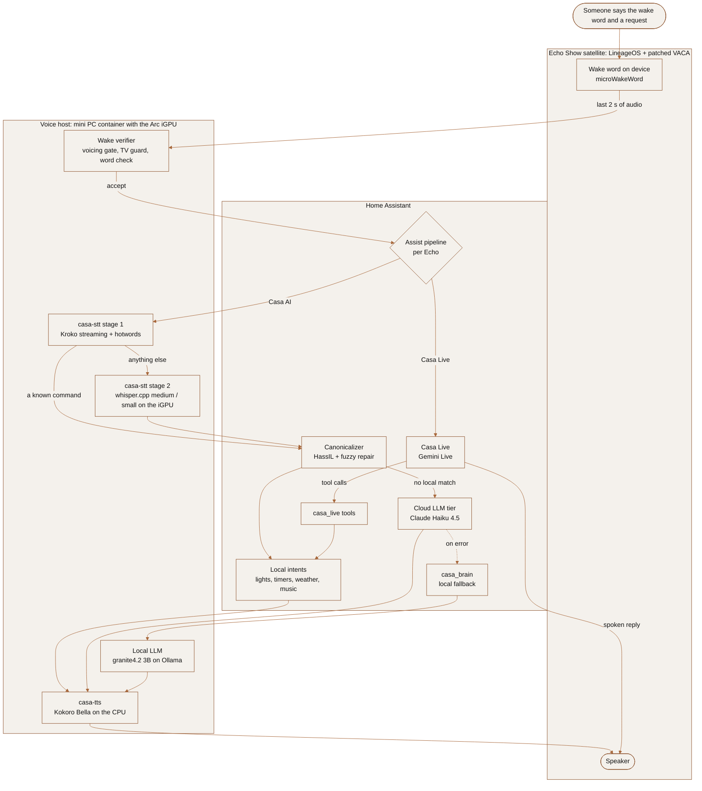

# Casa voice assistant

Casa is the voice assistant I built to replace Alexa on the three Echo Shows in my home: a wake verifier, a two-stage
speech-to-text server, local intents with an LLM tier behind them, and a streaming text-to-speech server, all running on
one mini PC, plus the benchmarks and the voice lab I used to make each decision.

## Why it exists

I wanted a voice assistant that runs at home: commands answered in well under a second, the microphone audio of my
home transcribed on my own hardware, and no cloud by default. In the local "Casa AI" chain the audio never leaves the
network and commands never wait for an LLM; only open questions the local tier can't answer go out, as text, to Claude.
Gemini Live is an opt-in alternative pipeline per room that streams audio to Google. It is what my Echos run today,
with the local chain one command away.

The satellites are Echo Show 5 and Echo Show 8 smart displays running LineageOS and a patched
[View Assist Companion App](https://github.com/msp1974/ViewAssistCompanionApp) (VACA) as Home Assistant satellites.
Everything after the on-device wake word is mine. The server is an Intel Core Ultra mini PC (Meteor Lake, Arc iGPU,
32 GB RAM) running Proxmox: Home Assistant in a VM with 4 vCPU, the voice services in a container with the iGPU passed
through.

## The pipeline



## Headline numbers

Speech-to-text on 64 synthetic clips (32 clean, 32 far-field), audio sent in real time, latency from the end of the
audio to the transcript. Every row is in [STT_TTS_BENCHMARKS.md](STT_TTS_BENCHMARKS.md).

| Engine | Latency clean / noisy | WER clean / noisy |
|---|---|---|
| **casa-stt v3** (Kroko streaming + hotwords, matcher gate, second stage) | **0.27 s / 0.33 s** | **0.5 % / 1.6 %** |
| Parakeet TDT 0.6B v3 (HA Whisper add-on) | 0.60 s / 0.64 s | 2.4 % / 3.8 % |
| Kroko zipformer streaming, beam 4 | 0.22 s / 0.21 s | 7.1 % / 7.3 % |
| Whisper base-int8 | 0.43 s / 0.45 s | 7.0 % / 10.0 % |
| Whisper small-int8 (the old default) | 1.13 s / 1.05 s | 3.8 % / 8.9 % |

Synthetic voices flatter Parakeet. On 13 real recordings of my own accented voice it returned nothing or nonsense on 6,
while whisper.cpp `medium` on the iGPU got all 13 in about 1.0 to 1.5 s, so medium became casa-stt's second stage.

Local LLMs on the Arc iGPU (Ollama, Vulkan, a 2.7k-token Home Assistant-like prompt; [LOCAL_AI_FINDINGS.txt](LOCAL_AI_FINDINGS.txt)):

| Model | Prompt reading | Generation |
|---|---|---|
| granite4.2:3b (the one I kept) | 209 tok/s | 10.0 tok/s (11.3 after raising the power limit) |
| gemma3:4b | 188 tok/s | 7.4 tok/s |
| qwen3.5:4b | 102 tok/s | 6.5 tok/s |
| lfm2.5:8b (8B-A1.5B MoE, reasoning only) | 373 tok/s | 14.2 tok/s |
| gemma4:26b-a4b QAT (MoE) | 48 tok/s | 5.1 tok/s |

The iGPU reaches about 22 GB/s of memory bandwidth for the model, so tokens/s is roughly 22 divided by the model size
in GB, and each generated token costs about 150 ms. granite4.2:3b passed 9 of 10 real Home Assistant commands, but any
command the model handles takes about 15 s.

End to end and per tier:

| What | Measured |
|---|---|
| Local command, end of speech to the answer starting | 0.5 to 0.8 s (was 2.5 s with Whisper small and the default end-of-speech wait) |
| 757 real turns over two days | stream fast path median 0.03 s; whisper path median 1.04 s, p90 1.77 s |
| End of speech to answer text, before and after one tuning round | median 3.63 s to 1.87 s, worst 9.6 s to 3.0 s |
| Claude Haiku 4.5 as the cloud tier | advice questions 1.4 to 2.2 s, follow-ups 1.4 to 1.8 s, with a web search about 3 s; about $0.0005 per question |
| Gemini Live | first reply audio 0.05 to 0.25 s after the audio ends for questions, about 1.6 s for a house action; estimated $7 to $10 a month |
| Text-to-speech | Piper: first audio 0.06 to 0.17 s. Kokoro "Bella" (picked by ear out of 13 samples): about 0.5 s, streamed sentence by sentence |

Wake word:

| Test | Result |
|---|---|
| Voicing gate | rejected 0 of 86 real wakes; 17 of 26 false wakes had under 60 ms of voiced speech |
| Word check (Kroko, "ALEXA" hotword, about 80 ms) | 360 of 360 synthetic "Alexa" accepted, 6 of 6 TV false wakes from one film rejected, 0 false hits in about 4,500 other clips |
| VACA patch: no mic mute during the wake blip | exact transcripts 0 of 23 to 15 of 24, mean WER 0.47 to 0.11 |

## Design decisions and trade-offs

- **Two stages for speech-to-text.** A streaming model transcribes while you talk, and Home Assistant's own sentence
  matcher (about 50 ms) decides whether the text is already a complete command. If it is, the answer starts about 0.05
  to 0.2 s after you stop talking. Only questions and misheard text pay for the accurate engine. The cost: a command
  the matcher doesn't know waits about a second for whisper.
- **Repairs are validated by the house.** Far-field audio turns "monitor light" into "moment lie". casa-stt tries known
  confusions, the closest device name for an unmatched slot, and a vocabulary repair, but only accepts a repair that
  Home Assistant can actually execute. An LLM acting on a fragment once set a light to 20 % because it heard "20%.", so
  garbled house commands get "Sorry, I didn't catch that" in under a second instead of a 30 to 60 s LLM guess.
- **Benchmark on real voices.** Parakeet won on synthetic clips and lost on my accent. The second stage is whisper.cpp
  medium on the iGPU; questions use whisper small (0.37 s instead of 0.84 s) because it gave the same text on my
  questions, while commands keep medium because small garbled device names.
- **Commands never go to the local LLM.** At 7 to 10 tokens/s a tool call plus a short confirmation has a floor of about
  15 s. The work went into making more phrasings hit the 0 s matcher (aliases, sentence templates, a fuzzy
  canonicalizer, a learning loop that lists what still fell through). Open questions go to Claude Haiku; the local
  model is the fallback when the cloud fails.
- **Keep the iGPU for what needs it.** Kokoro runs on 6 CPU threads; whisper and the LLM share the iGPU. Every granite
  caller uses the same `num_ctx` (16384), because Ollama reloads the model on any context change and 12288 produced
  garbage on Vulkan. A guard proxy caps generations at 400 tokens and a health check restarts Ollama after an iGPU
  hang, because a hung iGPU keeps answering with empty text.
- **The wake verifier can only remove wakes.** It answers within the Echo's 250 ms budget, and on any error or timeout
  the Echo goes ahead. Each check came from a real night of false wakes: door slams (voicing gate), TV dialogue in two
  rooms at once (pair rule), TV dialogue in the TV room (word check).
- **End of speech from the words, not a fixed silence.** Home Assistant ends a command after a fixed pause, which cut
  long questions at the first breath. `casa_endpoint` reads the live transcript and waits 2.2 s when the sentence
  sounds unfinished ("…and the"), 1.2 s for a plain statement, 0.7 s otherwise; with Gemini, Gemini's own end-of-speech
  decides and the mic closes the moment it answers.
- **Gemini Live as an option, not a replacement.** One realtime model hears, thinks and speaks, with a first reply in
  0.05 to 0.25 s and better handling of accents. It costs money and needs the cloud, so the local chain stays
  installed, and `setup_gemini_live.py --revert <room>` moves an Echo back.

## What's in each folder

| Path | What it is |
|---|---|
| `stt/` | casa-stt (two-stage Wyoming STT with hotwords and repair), the whisper.cpp server units, `ollama-guard`, `ollama-health`, `ollama-keepwarm`, example env and hotword files |
| `tts/` | casa-tts: Kokoro as a streaming Wyoming TTS server |
| `wake-verify/` | The wake verifier and its offline evaluations (`eval/`) |
| `vaca-patch/` | Patch scripts and Java helpers for VACA: silent first blip, no mic mute, barge-in, the verifier hook, instant volume keys, never revoking the HA login |
| `custom_components/` | Home Assistant integrations: `casa_endpoint` (smart end of speech), `casa_live` (tool API for Gemini Live + cost sensor), `casa_brain` (local LLM fallback agent), `casa_weather` (about 40 weather phrasings answered locally in about 10 ms) |
| `custom_sentences/`, `homeassistant/` | Sentences and a minimal package for the sentinel intents, the lab switch and the keep-warm automation |
| `patches/` | My changes to the Assist Canonicalizer as a diff against its 1.14.0 release: multi-command split, follow-up guard, silent TV turns, cancel button, Claude to local-brain failover, never speaking raw errors |
| `live/` | Gemini Live: setup script, prompt, and my patch to ha-gemini-live 1.0.11 |
| `claude/` | The Claude voice prompt and the script that pushes it into Home Assistant's Anthropic agent |
| `casa_prompt.txt` | The prompt of the local "Casa" agent (granite4.2:3b) |
| `ai-eval/` | Benchmarks and checks: STT, TTS, LLM speed, tool calling, real HA commands, a human-free voice self-test, a log reader for recent turns, the learning loop |
| `voice-lab/` | Synthetic clip generators, the lab runner that replays clips at a real Echo, offline wake-word evaluation and training data |
| `STT_TTS_BENCHMARKS.md` | Every speech engine I tried, with latency and WER |
| `LOCAL_AI_FINDINGS.txt` | The local LLM log: hardware limits, every model tried, routing, gotchas |

## How to run it

Most scripts talk to Home Assistant and read `HA_URL` and `HA_TOKEN` from the environment. Copy
`config.env.example` to `config.env` (it is gitignored), fill it in, and export it:

```bash
set -a; . ./config.env; set +a
```

**casa-stt, whisper, Ollama helpers** (voice host): see [stt/README.md](stt/README.md). In short: a venv in
`/opt/casa-stt` with `sherpa-onnx wyoming numpy aiohttp`, the Kroko model under `/opt/casa-stt/models/`, whisper.cpp
built with Vulkan in `/opt/whisper.cpp`, `casa-stt.env` and `whisper.env` from the examples, then
`systemctl enable --now whisper-server whisper-fast casa-stt ollama-guard ollama-health.timer`. Add a Wyoming entry
for `<voice host>:10310` in Home Assistant and pick `stt.casa_stt` in the pipeline. Logs:
`journalctl -u casa-stt -f`, one line per utterance with stage and timings.

**casa-tts** (voice host): a venv in `/opt/casa-tts` with `kokoro-onnx onnxruntime wyoming numpy`, the Kokoro v1.0 ONNX
model and voices file in `/opt/casa-tts/models/`, then `systemctl enable --now casa-tts` (`tts/casa-tts.service`,
port 10340). Add a Wyoming entry for it and pick voice `af_bella`.

**Wake verifier** (voice host): runs in casa-stt's venv on port 10350;
`systemctl enable --now wake-verify`. Set `URL_BASE` in `vaca-patch/CasaVerify.java` to it and build the patched VACA
([vaca-patch/README.md](vaca-patch/README.md)). Kill switch: `touch /opt/casa-stt/wake_verify.off`.

**Home Assistant side**: copy `custom_components/*` to `/config/custom_components/`, add `casa_endpoint:`,
`casa_live:` and `casa_weather:` to `configuration.yaml` (and a `casa_brain:` block with `house_agent`, `chat_url`,
`chat_model`, `chat_api_key` if you use it), copy `custom_sentences/en/*` and `homeassistant/packages/casa_voice.yaml`,
then restart. Install the Assist Canonicalizer 1.14.0 and ha-gemini-live 1.0.11 from HACS and apply my patches from
`/config`: `patch -p1 < assist_canonicalizer-1.14.0-casa.patch` and `patch -p1 < gemini_live-1.0.11-casa.patch`.

**Pipelines and prompts**: `python3 live/setup_gemini_live.py` creates or refreshes the Gemini Live entry and the
"Casa Live" pipeline; `--assign <room>` / `--revert <room>` move one Echo between Casa Live and Casa AI. Edit
`claude/voice_prompt.txt`, then `python3 claude/apply_voice_prompt.py`.

**Benchmarks**: `python3 ai-eval/stt_bench.py gen` (macOS `say` + ffmpeg) and
`python3 ai-eval/stt_bench.py run <voice host>:10310 --realtime --set all`; `tts_bench.py run <host>:10340`;
`llm_bench.py granite4.2:3b` on the voice host. `python3 ai-eval/voice_log.py 20` prints the last 20 turns: what was
heard, who answered, what was said, stage timings.

**Voice lab**: turn on `input_boolean.casa_voice_lab`, then
`python3 voice-lab/run_lab.py --tag <name> --volume 0.25 --match '<clip regex>' --gap 45`.

## Limitations

- It is built around my house: Echo Shows with VACA, Home Assistant, English, and the device names and rooms in the
  examples. Placeholders in `<>` and the `.example` files are where your own values go.
- Not included: the phone chat pipe (Open WebUI), the Echo dashboard, and my integrations for timers, music, routines,
  recipes and shared lists. `casa_live`'s chore and grocery tools call one of those (`casa_tasks`); `house` works on
  its own.
- casa-stt's hotwords and repair rules are tuned to my accent and my devices; on another voice they need their own
  confusion table, which `voice_log.py` and `assist_learn.py` help build.
- The recordings, wake-word models and lab results are not published (they contain real voices from my home), so the
  wake-word and real-voice numbers can't be reproduced from this repo. Two of the 16 STT benchmark sentences differ
  from the measured set.
- The Arc iGPU hangs under long compute batches unless the i915 heartbeat and preempt timeouts are raised on the host,
  and Vulkan on it corrupts some models' output (Gemma 4 12B / E4B on long prompts, granite at `num_ctx` 12288).
- The VACA patches edit smali of VACA 0.13.x and must be redone after every VACA update; a patched build has a
  different signature from the official app.
- Gemini Live needs a paid key, Google Search grounding has to stay off (it cuts audio turns), and its own
  end-of-speech sometimes ends a turn at a 1.3 s mid-sentence pause.
- Paths like `/opt/casa-stt` and ports are hard-coded defaults; most can be overridden with arguments or environment
  variables.

## Licence

My code and documents are under the MIT licence ([LICENSE](LICENSE)). The two patch files contain lines of MIT-licensed
upstream code, and the VACA patches modify an Apache-2.0 app: see [NOTICE](NOTICE).
